  <a href="https://maulanaridho.netlify.app/" target="_blank" rel="noreferrer">
    <picture>
      <source media="(prefers-color-scheme: dark)" srcset="./assets/header-dark.svg" />
      <source media="(prefers-color-scheme: light)" srcset="./assets/header-light.svg" />
      
    </picture>
  </a>

  
  
  
  
  
  

 

I'm a **Full-Stack Developer** based in **Jakarta, Indonesia**, building scalable web platforms with **Laravel** and **Next.js**, backed by **PostgreSQL**. Before writing code full-time, I spent two years leading digital media production at **MileniaNews** — planning, editing, and shipping **2,000+ pieces** of content at scale. Now I build the tools I used to need, bridging engineering and real editorial workflows.

### 🧐 More About Me

- 🔭 &nbsp; Currently working on **Milenner Platform** — a multi-tenant content operations & Kanban platform for social media teams (`Next.js 16`, `React 19`, `TypeScript`, `Supabase`)
- 🌱 &nbsp; Currently deepening **scalable system architecture**, **PostgreSQL performance**, and **applied web cryptography**
- 🔬 &nbsp; Built applied research on **Medical Record Encryption** at **Universitas Bina Sarana Informatika**
- 🎬 &nbsp; 2+ years experience as a **Digital Media Specialist** at **MileniaNews** (2,000+ pieces shipped) & IT Support background at **Gedung Bidakara**
- 💬 &nbsp; Ask me about **Laravel, Next.js, TypeScript, PostgreSQL, Supabase**, or **digital media production pipelines**
- 📫 &nbsp; How to reach me: [maulridho04@gmail.com](mailto:maulridho04@gmail.com) · [LinkedIn](https://www.linkedin.com/in/ridho-maulana-073aaa386/) · [WhatsApp](https://wa.me/6289618775467)
- 📄 &nbsp; Explore my full portfolio at [maulanaridho.netlify.app](https://maulanaridho.netlify.app/) or view my [Resume / CV](https://maulanaridho.netlify.app/CV-Ridho-Maulana.pdf)

 

### 🔨 Languages and Tools

  <a href="https://skillicons.dev" target="_blank" rel="noreferrer">
    <picture>
      <source media="(prefers-color-scheme: dark)" srcset="https://skillicons.dev/icons?i=react,nextjs,ts,tailwind,php,laravel,py,postgres,mysql,supabase,docker,figma,pr&perline=7&theme=dark" />
      <source media="(prefers-color-scheme: light)" srcset="https://skillicons.dev/icons?i=react,nextjs,ts,tailwind,php,laravel,py,postgres,mysql,supabase,docker,figma,pr&perline=7&theme=light" />
      
    </picture>
  </a>

  

 

### 📊 GitHub Stats

  <a href="https://github.com/ridhomaul">
    <picture>
      <source media="(prefers-color-scheme: dark)" srcset="https://github-readme-stats.vercel.app/api?username=ridhomaul&show_icons=true&theme=github_dark&hide_border=true&custom_title=Ridho%20Maulana's%20GitHub%20Stats" />
      <source media="(prefers-color-scheme: light)" srcset="https://github-readme-stats.vercel.app/api?username=ridhomaul&show_icons=true&theme=default&hide_border=true&custom_title=Ridho%20Maulana's%20GitHub%20Stats" />
      
    </picture>
  </a>
  <a href="https://github.com/ridhomaul">
    <picture>
      <source media="(prefers-color-scheme: dark)" srcset="https://github-readme-stats.vercel.app/api/top-langs/?username=ridhomaul&layout=compact&theme=github_dark&hide_border=true" />
      <source media="(prefers-color-scheme: light)" srcset="https://github-readme-stats.vercel.app/api/top-langs/?username=ridhomaul&layout=compact&theme=default&hide_border=true" />
      
    </picture>
  </a>

 

### 🐍 Contribution Activity

  <picture>
    <source media="(prefers-color-scheme: dark)" srcset="https://raw.githubusercontent.com/ridhomaul/ridhomaul/output/github-contribution-grid-snake-dark.svg" />
    <source media="(prefers-color-scheme: light)" srcset="https://raw.githubusercontent.com/ridhomaul/ridhomaul/output/github-contribution-grid-snake.svg" />
    
  </picture>

 

  <picture>
    <source media="(prefers-color-scheme: dark)" srcset="./assets/footer-dark.svg" />
    <source media="(prefers-color-scheme: light)" srcset="./assets/footer-light.svg" />
    
  </picture>

